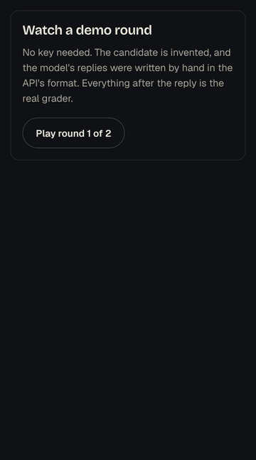
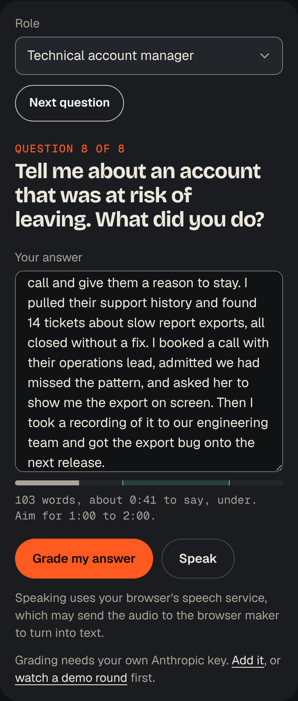
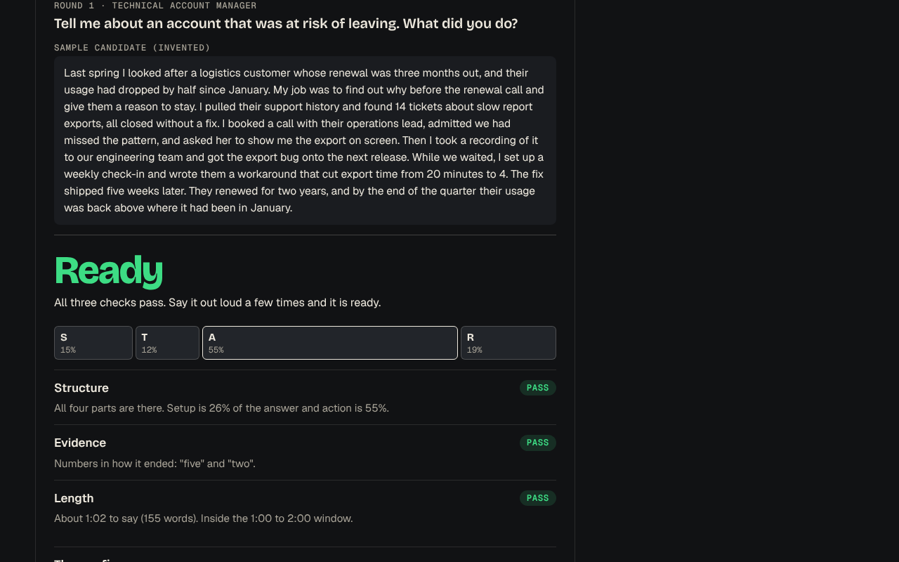

# Interview Room

**A mock interviewer that asks one question at a time and grades your STAR answers.**

[**Try it live**](https://daksh2197.github.io/interview-room/) in any browser. Free, no sign-up. Grading uses your own Anthropic key; the demo round needs nothing.

[](https://github.com/daksh2197/interview-room/actions/workflows/ship.yml)
[](LICENSE)

<p align="center">
  
</p>

STAR is the usual shape for a behavioural answer: the Situation, your Task, the Action you took, and the Result.

## Why I built it

Interview prep usually means reading a list of fifty questions and nodding. That is not practice. Practice is being asked one question, answering it, and hearing what was missing. I wanted that available any time, without booking anyone.

## What it does

- **Asks one question at a time.** Forty questions across five role families: general behavioural, technical account manager, customer success, solutions engineer, and race or trackside engineer. No repeats until you've had all eight in a set.
- **Times your answer as you type.** Words become an estimated speaking time, with the one-to-two-minute window marked on a bar.
- **Grades three things.** Structure (are all four STAR parts there, and in proportion), evidence (a number in how it ended, or a concrete outcome) and length. Three passes is Ready, two is Close, one or none is Rework.
- **Gives you one fix and a tighter version.** The rewrite may only use facts you wrote. If it contains a number you never wrote, it is thrown away and you see the grade without it.
- **Keeps a story bank.** Your own stories, with the number that proves each one, stored in your browser. Export and import them as a JSON file.
- **Runs on your key, in your browser.** The key stays in the browser, goes only to Anthropic, and one button forgets it. There is no server in between.
- **Has a demo round that needs no key and no signal.** An invented candidate and two scripted model replies, run through the real grader.
- **Takes dictation where the browser can.** A Speak button appears in browsers with speech recognition. The page says that the browser's speech service may send audio to the browser maker.



## The hard part in 30 seconds

Language models are good at reading and bad at counting. So the model only reads:

```
model:  copy out the Situation, Task, Action and Result sentences, word for word
        say whether there is a concrete outcome
        suggest one fix and a tighter rewrite
code:   check every copied sentence is really in the answer (drop it if not)
        measure each part's share of the words
        count each word once, in the first part that claims it
        look for a number in the Result, not in the setup
        time the answer at 150 words a minute
        pass or fail three checks, add them up
        throw the rewrite away if it has a number you never wrote
```

The model's reply is forced into a JSON schema by the API, then checked again on arrival. The prompt lives in code with a version number, and an eval set of 11 sample answers says whether a prompt change made grading better or worse.



The long version, with the whole prompt and why each rule is there, is in [docs/THE-PROMPT.md](docs/THE-PROMPT.md).

## Run it yourself

You need [Node.js](https://nodejs.org) 22.12 or newer.

```bash
git clone https://github.com/daksh2197/interview-room.git
cd interview-room
npm install
npm run dev     # the app, live-reloading, at http://localhost:5173
npm test        # every test, against a mocked API: no key needed
npm run build   # the finished site, in dist/
```

To run the evals against the live API, billed to your own key:

```bash
ANTHROPIC_API_KEY=sk-ant-... npm run evals
```

## How it's built

| Piece | Job | Why this one |
| --- | --- | --- |
| TypeScript | The language | The grade's shape is a type, so the screen can't read a field that isn't there |
| Vite | Builds the site | One command, well under a second |
| Vitest | Runs the tests | The whole grading pipeline is tested against a fake API |
| No framework | The screen | One screen and a few forms don't need React |
| Anthropic Messages API | Reads the answer | Called straight from the browser with the user's key, with structured outputs |
| Service worker | Offline | The demo round works with no signal |
| GitHub Actions | Test, then deploy | Every push to main and every pull request runs the tests. If one fails, nothing ships |
| GitHub Pages | Hosting | Free |

The map:

```
src/
  core/              the brain: no screen, no network
    prompt.ts        the prompt, its version, the request body. Start here.
    schema.ts        the shape the model must answer in, and the check that it did
    score.ts         the judge: verifies excerpts, measures parts, picks the band
    numbers.ts       the "no invented numbers" check
    grade.ts         the pipeline, start to finish, with send() passed in
    speaking.ts      words to speaking time
    questions.ts     the 40 questions and the no-repeat rule
    stories.ts       the story bank, export and import
    demo.ts          the scripted demo round
    words.ts         every sentence the grader writes
    *.test.ts        the tests, next to the code they check
  api/anthropic.ts   the only file that touches the network
  ui/report.ts       draws a grade
  ui/speech.ts       voice typing, where the browser has it
  main.ts            wires the page to the brain
evals/
  cases.json         11 sample answers and what each check should say
  run.ts             runs them against the live API: npm run evals
  cases.test.ts      what CI checks about the cases with no key
public/sw.js         the offline worker
.github/workflows/ship.yml  test, then deploy
```

Want the guided tour? [docs/CTO-NOTES.md](docs/CTO-NOTES.md) explains every idea in here in plain English, how to debug it, and five small changes to try. The money side is in [docs/BUSINESS.md](docs/BUSINESS.md).

## What got caught along the way

- **The judge failed my own test answer.** I wrote a short billing story to test the pipeline. The grader said Structure: fail. Setup was 45% of the words and the rule is 40%. I had written the kind of answer the tool exists to catch, so I fixed the answer, not the rule.
- **The number check was stricter than my test.** A browser check during the build fed the grader a reply with some HTML in it, `window.__xss=1`, and a planted "99 hours", to prove the HTML would show as text and the 99 would be caught. Both happened. The check also flagged the "1", because the candidate never wrote a 1. My test expected only the 99. The test was wrong, not the check: every digit counts. The word "one" is let through, since "one of the customers" isn't a claim.
- **The browser needs a permission slip.** The API only answers a web page if the request carries the `anthropic-dangerous-direct-browser-access` header. I checked it both ways against the live API: without the header there is no CORS header on the reply, so the browser hides it. The "dangerous" is about the key being visible to the page, which is the point when it is your own key on your own device.
- **Screenshots caught two layout bugs the tests couldn't.** At 1440 pixels wide the footer was narrower than the header, because a page-width rule got lost when I copied the base styles. At 320 pixels the Task block in the STAR bar was too thin to show "12%". Both are fixed.

- **An outside review found eight bugs the tests had missed.** Before this went anywhere it got a cold read from a second Claude session that hadn't seen it being built. The worst: press Grade, then Next question while the reply is on its way, and the grade for question 1 landed under question 2. It also found that one sentence filed under all four STAR parts counted four times (the bar read 83% four times over), that a quote could match the middle of a word, that "Two years ago" in the setup passed the evidence check, that the page could say "Setup is 40%. Keep it under 40%", that a leftover "too short" message could sit under a newer one, that one-word quotes were reported as made up, and that the CI workflow would fail on its first public push. All fixed, each with a test where a test can catch it.

## How this was built

I build with Claude as my pair programmer. I bring the problem and decide what the thing should do. Claude writes most of the code. I review it until I can explain every file, and [the CTO notes](docs/CTO-NOTES.md) are my study guide, in public. Every commit carries the co-author line.

## What's next

- [ ] Run the evals against the live API and record the first table in THE-PROMPT.md
- [ ] A timer mode: answer out loud, then type what you said
- [ ] Follow-up questions ("what would you do differently?") after a grade
- [ ] Question packs written for specific roles, as files you can import

This is practice. It can tell you whether an answer is clear. It can't tell you whether you'll get the job. Not affiliated with Anthropic.

## License

[MIT](LICENSE). Use it, fork it, write your own questions.

The typefaces, Bricolage Grotesque, Geist and Geist Mono, are bundled from Fontsource under the SIL Open Font License 1.1.

Built in Calgary by [Daksh Dua](https://dakshdua.ca).
